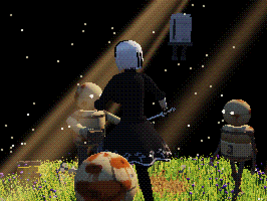
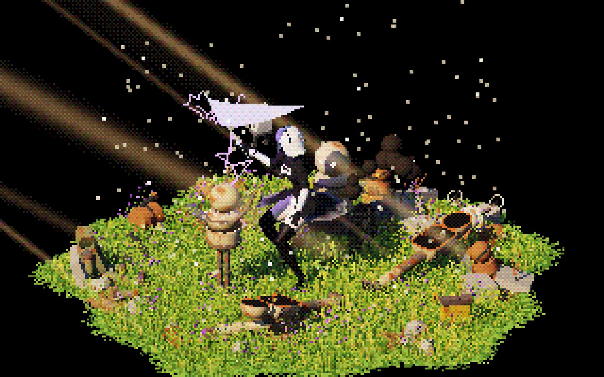

# Pixel Dance (2B)



A pixel-art, real-time 3D fan-art animation of 2B from *NieR:Automata*, made with three.js. She stands in tall, wind-blown grass ringed by robot wreckage, with her Pod floating at her shoulder.
Three machines close in. She draws her sword, backflips through the first one, then cuts the other two down with a spinning slash and sheathes again. The scene loops in about 16 seconds.

**Part 2 of 3:** basketball → **2b-animation** → test-game

## Run

```sh
python3 -m http.server 8765
```

Then open http://localhost:8765/dance.html. There's no build step. three.js `0.160.0` loads from jsdelivr, so you need internet.

| Input | Action |
|---|---|
| click | turn on sound (browsers block audio until you interact) |
| drag / scroll | orbit / zoom |
| `C` | cinematic "robot cam": one continuous take that orbits the whole scene |
| `O` | wide steady orbit |
| `R` | record one loop to an `.mp4` file, with sound |
| `M` | mute |

URL flags: `?cine` and `?orbit` open in a camera mode. Add `&rec` to record the first loop after a click.

## Code layout

The code is plain ES modules with no bundler. Each module builds its part of the scene when it's imported, so the import order in `main.js` is also the order the scene gets built in.

```
dance.html          page shell: styles, the import map (three + addons), loads src/main.js
src/
  main.js           the frame loop: pose, feet, backflip, camera, fight, effects, sound, physics, render
  stage.js          renderer, scene, cameras, lights, the low-res + dither pass with cinematic bars
  util.js           small helpers: lathes, pivots, meshes, canvas textures, easing
  grass.js          the ground, 16,000 wind-blown grass blades, dead spots, purple flowers
  wrecks.js         broken machine robots and rusting painted robots (set dressing)
  machines.js       the three live machines she fights, each built in two pieces so a cut can split it
  rubble.js         seeded tech rubble around the stage
  character.js      the model: materials, body, skirt shape, bust, face, hair shapes, arms, katana
  pod.js            the floating companion
  choreo.js         poses, the choreography timeline, spline + spring smoothing, the backflip, the rest idle
  feet.js           planted feet, stepping, and 2-bone leg IK
  physics.js        bust springs, the Verlet skirt cloth, the Verlet hair strands
  fight.js          machines walking up and getting cut, the slash trail, purple lightning, blasts
  atmosphere.js     drifting motes and sun rays (stencilled so they never cross her)
  sound.js          the generated Web Audio score and sound effects
  cinema.js         the robot-cam move, slow-mo ramps, the wide orbit, video recording
```

## Videos

The rendered videos are `pixel-dance-cinematic.mp4` and `pixel-dance-orbit.mp4`. Both are 1920×1440 at about 55 fps.
Each one is about 200 MB, which is over GitHub's 100 MB file limit, so `.gitignore` keeps them out of the repo. To publish them, use Git LFS or attach them to a GitHub Release.

## What's in it



- **Character:** built from lathe profiles, with a bob of physically simulated hair strands, a blindfold, a high collar, puffy sleeves, gloved hands with jointed fingers and thigh-high boots.
- **Motion:** spline-keyed poses smoothed by springs. The feet use 2-bone IK, so planted feet stay locked, and steps lift and point.
- **Cloth:** the skirt is a Verlet cloth with thigh colliders. It flares on the spin.
- **Fight:** a full backflip and a spinning slash. Each machine splits along the cut, and the cut faces glow white-hot and cool. There's purple lightning on the blade, a slash trail, spark bursts and smoke blasts.
- **Pod:** a detailed floating companion that lags behind her turns.
- **World:** 16,000 instanced grass blades with shader wind, dead patches, tiny purple flowers, drifting motes, and sun rays that land on the grass and never cross her.
- **Sound:** fully generated with Web Audio, with no audio files. It has a wind bed, a pad, arpeggio and drum score, machine footsteps, a sword draw, whooshes, crackles, clangs and booms.

## Inspiration

The direct sources were reference images of 2B, the enemy machines from the game and a dance clip that the original choreography was read from.
The deeper root is **basketball**. That project produced the pixel/dither pipeline and the golden-sun lighting, and showed that hand-animated jointed figures could look fluid. This project points that same camera at one character and pushes it as far as it goes: hair, cloth, IK feet and a real fight.

## What it led to

Once there was a sword fighter, swaying grass, sun shafts, sparks, slash arcs and machine enemies to cut down, it was already halfway to a game. The only missing piece was letting someone hold the controller.
That became **test-game**. It's a playable top-down action RPG built on the same pipeline and the same combat feel.

*Fan art. 2B and NieR:Automata belong to Square Enix.*
